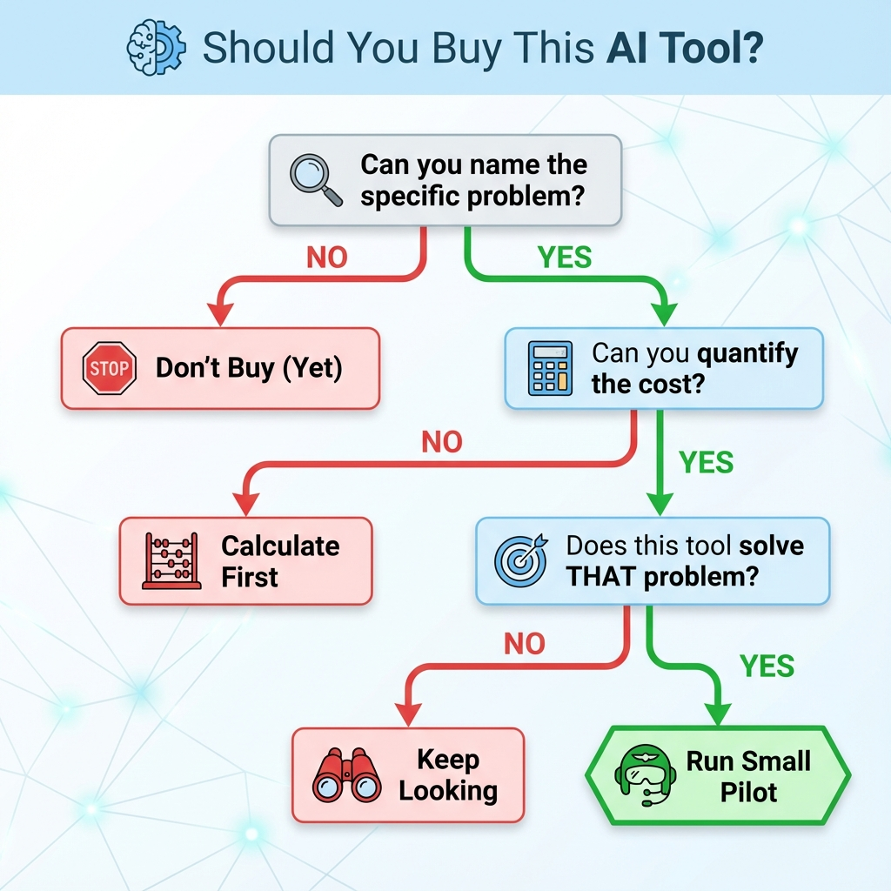

# Awesome AI Marketing

> A curated list of the AI skills, agents, MCP servers and tools marketers actually run, with honest notes on what each one is good for and who's behind it.

**Last updated: November 2026** · Maintained by [Max Braglia](https://maxbraglia.com)

A year ago, "AI marketing" meant picking the right SaaS tool. Today a growing share of the work runs inside an AI assistant (Claude, ChatGPT/Codex, Cursor) using **skills** (reusable instructions), **MCP servers** (live connections to your ad accounts, analytics and CRM) and **agents** (multi-step workflows). This list is organized around that shift. The SaaS tools are still here, trimmed to the ones worth a look.

**How to read the notes:** every entry says what it's good for. When an open-source project mainly exists to send you to a paid product, it's marked **vendor-backed**. That doesn't make it bad. It just means you should know.

⭐ If this saves you research time, star it and share it with a marketer who's drowning in tool options.

---

## Contents

- [Start Here: Skills, MCP and Agents in Plain English](#start-here-skills-mcp-and-agents-in-plain-english)
- [Marketing Skill Packs](#marketing-skill-packs)
- [MCP Servers for Marketing Data](#mcp-servers-for-marketing-data)
- [AI Search Visibility (AEO / GEO)](#ai-search-visibility-aeo--geo)
- [Workflows & Automation](#workflows--automation)
- [Verification & Regulated Content](#verification--regulated-content)
- [Tools by Job](#tools-by-job)
- [Before You Buy Anything](#before-you-buy-anything)
- [Contributing](#contributing)

---

## Start Here: Skills, MCP and Agents in Plain English

- **Skill:** a folder of instructions (a `SKILL.md` plus references) that teaches an AI assistant how to do one job your way, like "audit a landing page" or "write a cold email sequence". Write once, reuse forever.
- **MCP server:** a connector that gives the assistant live access to a system: Google Ads, GA4, Search Console, HubSpot, your CMS. Without one, the AI works from whatever you paste in. With one, it works from your real data.
- **Agent:** an assistant that runs a multi-step task on its own, using skills and MCP connections, and hands you the result to review.

### Where to Run Them

- **[Claude Code](https://code.claude.com/docs/en/overview)**: Anthropic's agent for the terminal, desktop and IDEs. Despite the name, much of the marketing skills ecosystem was built for it first. Supports [skills](https://code.claude.com/docs/en/skills), [MCP](https://code.claude.com/docs/en/mcp) and plugins.
- **[Claude Cowork](https://claude.com/product/cowork)**: Claude's agent for knowledge work on your files and apps, with no terminal involved. The friendliest entry point for non-technical marketers.
- **[OpenAI Codex](https://learn.chatgpt.com/docs)**: OpenAI's agent. Supports [skills](https://learn.chatgpt.com/docs/build-skills) and MCP, and most skill packs below install into it too.
- **[VS Code](https://code.visualstudio.com)**: The classic free editor, still one of my daily tools. Use it to inspect files and review what an agent changed, or run agents inside it with the [Claude Code](https://marketplace.visualstudio.com/items?itemName=anthropic.claude-code) and [Codex](https://marketplace.visualstudio.com/items?itemName=openai.chatgpt) extensions.
- **[Cursor](https://cursor.com)**: AI code editor. Useful if you also build landing pages or internal tools.

### Learn the Building Blocks

- [Agent Skills](https://agentskills.io): The open skills format, now shared across Claude, Codex, Cursor and many other agents.
- [anthropics/skills](https://github.com/anthropics/skills): Anthropic's official example skills, including document skills (Word, Excel, PowerPoint, PDF) that marketers use daily.
- [Model Context Protocol](https://modelcontextprotocol.io): The MCP spec and docs. Start with the intro, skip the rest unless you're building.
- [The 5-Step Framework I Use With AI Coding Agents](https://maxbraglia.substack.com/p/the-5-step-framework-i-use-with-ai-codiing-agents): Idea, spec, plan, build, verify. How I work with agents day to day.

### Directories of Skills (All Disciplines)

- [VoltAgent/awesome-agent-skills](https://github.com/VoltAgent/awesome-agent-skills): The broadest index, 1,000+ skills across agents.
- [ComposioHQ/awesome-claude-skills](https://github.com/ComposioHQ/awesome-claude-skills): The most-starred Claude skills list. General purpose, with some marketing entries.

---

## Marketing Skill Packs

Install one, try it on a real task, and keep what works. You don't need all of them. Most install with one command into Claude Code, Codex or Cursor.

### Generalist Packs (Start With One)

- **[coreyhaines31/marketingskills](https://github.com/coreyhaines31/marketingskills)**: The reference pack and the most-starred marketing skills repo on GitHub. Skills for CRO, copywriting, SEO, paid ads, email, launches, pricing and more. They share a `product-marketing` context file, so every skill knows your product and audience. Best overall starting point. MIT. Funded by disclosed "verified partners" listed in the README.
- **[aaron-he-zhu/aaron-marketing-skills](https://github.com/aaron-he-zhu/aaron-marketing-skills)**: 120 skills across seven disciplines (narrative, SEO/GEO, social, email, paid, influencer, launch), each with scored quality gates. The most ambitious pack, and the heaviest. Pick it if you want structure; skip it if you want something light. Apache-2.0.
- **[ericosiu/ai-marketing-skills](https://github.com/ericosiu/ai-marketing-skills)**: Skills built around AI search and turning traffic into pipeline: SEO ops, outbound, lead research, CRO, revenue attribution. Strong for B2B. Vendor-backed: many skills connect through Single Grain's hosted MCP gateway. MIT.
- **[zubair-trabzada/ai-marketing-claude](https://github.com/zubair-trabzada/ai-marketing-claude)**: `/market audit <url>` runs parallel agents and returns a scored marketing audit, plus copy, email, social and ad commands. Built for freelancers and agencies who sell audits. Quick to try. MIT.

### SEO & AI Search Skills

- **[AgriciDaniel/claude-seo](https://github.com/AgriciDaniel/claude-seo)**: A full SEO audit plugin with sub-skills and specialist agents for technical SEO, E-E-A-T, schema, local, e-commerce and GEO. Hands you a prioritized action plan. The strongest open-source SEO audit for Claude Code. MIT.
- **[nowork-studio/notfair-plugin](https://github.com/nowork-studio/notfair-plugin)**: SEO, GEO, Google Ads, Meta Ads, GA4/Search Console and WordPress workflows, with explicit approval steps before any change goes live. Good if you want one plugin that covers organic and paid. MIT.
- **[onvoyage-ai/gtm-engineer-skills](https://github.com/onvoyage-ai/gtm-engineer-skills)**: A pipeline of AEO/GEO skills: brand research, prompt targets, content planning, writing, claim verification, website AEO audit and fixes. Each step writes a file the next step reads. MIT.
- **[Ryze-AI-Adgent/open-seo-mcp-skills](https://github.com/Ryze-AI-Adgent/open-seo-mcp-skills)**: SEO and GEO skills that work from your real Search Console and GA4 data, not estimates. Vendor-backed: built around Ryze's hosted MCP connector. MIT.

### Paid Ads & Creative Skills

- **[irinabuht12-oss/marketing-skills](https://github.com/irinabuht12-oss/marketing-skills)**: Dozens of skills for Google, Meta, LinkedIn and Reddit Ads audits, plus SEO and AI visibility. Practical diagnostics ("why did my CPA go up?"). Vendor-backed: designed around Ryze's hosted MCP. No license file.
- **[SupercmoHQ/superCMO-skills](https://github.com/SupercmoHQ/superCMO-skills)**: Skills plus a local MCP server that turn a product photo and a brief into ad creative: UGC-style video, product photography, image ads. Apache-2.0.
- **[smixs/creative-director-skill](https://github.com/smixs/creative-director-skill)**: An ideation skill that applies 20+ structured creativity methods (SCAMPER, TRIZ, synectics) and scores the ideas. Useful when campaign concepts all start to sound the same. CC-BY-4.0.

### Specialized

- **[ishwarjha/claude-marketing-research-skill](https://github.com/ishwarjha/claude-marketing-research-skill)**: Structured market research: competitors, customer avatars, positioning. Apache-2.0.
- **[vercel-labs/marketing-team-eve-template](https://github.com/vercel-labs/marketing-team-eve-template)**: A template for a team of marketing agents. For builders who want to run agents as an app, not inside a chat. MIT.

---

## MCP Servers for Marketing Data

Connect your assistant to the systems where your numbers live. **Start read-only.** Give an agent write access to an ad account only after you've watched it work. Official servers come first in each group.

### Analytics & Search Data

- **[OpenSEO MCP](https://openseo.so/docs/mcp)**: My go-to. Keyword, backlink, rank and site audit data in Claude, ChatGPT or Cursor, at usage-based prices well below the big suites. Open source ([GitHub](https://github.com/every-app/open-seo)), MIT. [More on OpenSEO below](#seo).
- **[Google Analytics MCP](https://github.com/googleanalytics/google-analytics-mcp)**: Official, Apache-2.0. Ask GA4 questions in plain English.
- **[AminForou/mcp-gsc](https://github.com/AminForou/mcp-gsc)**: Search Console insights in Claude: queries, pages, CTR gaps, indexing. Built by an SEO for SEOs. Community, MIT.
- **[ahonn/mcp-server-gsc](https://github.com/ahonn/mcp-server-gsc)**: A lighter Search Console alternative. Community, MIT.
- **[Ahrefs MCP](https://docs.ahrefs.com/en/mcp/docs/introduction)**: Official, hosted. Ahrefs keyword, backlink and site data in your assistant. Requires an Ahrefs plan.
- **[Semrush MCP](https://www.semrush.com/kb/1618-mcp)**: Official, hosted. Live Semrush data in AI tools. Requires a Semrush plan.
- **[DataForSEO MCP](https://github.com/dataforseo/mcp-server-typescript)**: Official. Pay-per-request SERP, keyword and backlink data. Cheaper than a suite subscription if you only need raw data.

### Ads

- **[Google Ads MCP](https://github.com/googleads/google-ads-mcp)**: Official. Query campaigns, performance and search terms.
- **[pipeboard-co/meta-ads-mcp](https://github.com/pipeboard-co/meta-ads-mcp)**: Meta (Facebook/Instagram) Ads for Claude, ChatGPT and Cursor. Community.
- **[hermoso-ai/hermoso](https://github.com/hermoso-ai/hermoso)**: MCP server and CLI that let Claude, ChatGPT, Codex or Cursor research competitors' ads, make image and video ads, publish to social channels, and build and read campaigns on 16 ad platforms (Meta, Google, Microsoft, LinkedIn, TikTok, Reddit and more). Campaigns are created paused. Vendor-backed: connects to Hermoso's hosted service, which has a free plan. MIT.

### CRM, Email & Commerce

- **[HubSpot MCP](https://developers.hubspot.com/ai-tools/mcp)**: Official. CRM records, deals and marketing data.
- **[Klaviyo MCP](https://developers.klaviyo.com/en/docs/klaviyo_mcp_server)**: Official. Email and SMS performance, segments and campaigns.

### Web Data & Research

- **[Firecrawl MCP](https://github.com/firecrawl/firecrawl-mcp-server)**: Official. Search and scrape web pages into clean text. Great for competitor research.
- **[Apify MCP](https://github.com/apify/apify-mcp-server)**: Official. Thousands of ready-made scrapers for social, maps, search and marketplaces.
- **[Bright Data MCP](https://github.com/brightdata/brightdata-mcp)**: Official. Public web data at scale, with unblocking built in.

### Glue

- **[Zapier MCP](https://zapier.com/mcp)**: Official. One connector to thousands of apps. The fastest way to let an assistant act in tools that don't have their own MCP.
- **[n8n-mcp](https://github.com/czlonkowski/n8n-mcp)**: Lets Claude, ChatGPT or Cursor build, debug and edit n8n workflows. Pairs with [n8n-skills](https://github.com/czlonkowski/n8n-skills). Community, MIT.

---

## AI Search Visibility (AEO / GEO)

People now ask ChatGPT, Perplexity, Gemini and Google AI Mode for recommendations. If you're not in the answer, you're not on the shortlist. Some of this is new. Much of it is SEO fundamentals done properly: plain-language pages that say exactly what you do, who you serve and what it costs.

### Guides & Primary Sources

- [Google: AI features and your website](https://developers.google.com/search/docs/appearance/ai-features): Google's own guidance on AI Overviews and AI Mode. Short version: no special markup, just helpful, crawlable content.
- [OpenAI: Overview of OpenAI crawlers](https://developers.openai.com/api/docs/bots): What OAI-SearchBot and GPTBot do, and how to allow ChatGPT search without allowing training.
- [GEO: Generative Engine Optimization (Princeton et al.)](https://arxiv.org/abs/2311.09735): The paper that named the field. Citing sources, adding statistics and quoting experts measurably raised visibility in AI answers.
- [llms.txt](https://llmstxt.org/): A proposed file that points AI tools to your key content. Cheap to add. Don't expect miracles: major AI search engines haven't committed to using it.
- [amplifying-ai/awesome-generative-engine-optimization](https://github.com/amplifying-ai/awesome-generative-engine-optimization): A deeper GEO reading list of guides, research and tools.

### Check Your Basics

- [AI Bot Access Analyzer](https://ai-bot-analyzer.maxtermedia.com/): Free. Checks whether AI crawlers can actually reach your site. I built it after client audits kept turning up sites whose robots.txt said "allow" while the CDN or firewall blocked the bots anyway ([how it works](https://maxbraglia.substack.com/p/building-an-ai-bot-access-checker)).

### Visibility Trackers (Commercial)

- **[Semrush AI Visibility Toolkit](https://www.semrush.com/kb/1493-ai-visibility-toolkit)**: Brand mentions and citations across ChatGPT, Perplexity and AI Overviews. The easy pick if you already pay for Semrush.
- **[Ahrefs Brand Radar](https://ahrefs.com/brand-radar)**: Your brand's AI visibility against competitors, built on Ahrefs' data.
- **[Otterly.AI](https://otterly.ai)**: Daily prompt and citation monitoring with alerts. Affordable entry point for SMBs and agencies.
- **[Peec AI](https://peec.ai)**: Prompt tracking, share of voice and source analysis for marketing teams.
- **[Profound](https://www.tryprofound.com)**: Enterprise-grade AI visibility platform.
- **[SE Ranking AI Overviews Tracker](https://seranking.com/ai-overviews-tracker.html)**: Focused on Google AI Overviews: which keywords trigger them and who gets cited.

### Visibility Trackers (Open Source)

- **[elmohq/elmo](https://github.com/elmohq/elmo)**: Track how AI engines mention and cite your brand. Self-hostable. MIT.
- **[limelit-co/open](https://github.com/limelit-co/open)**: Self-hosted tracking across ChatGPT, Claude, Perplexity, Gemini and Google. Apache-2.0.
- **[danishashko/geo-aeo-tracker](https://github.com/danishashko/geo-aeo-tracker)**: Lightweight tracker plus AEO checker. MIT.
- **[yaojingang/GEOInflow](https://github.com/yaojingang/GEOInflow)**: Self-hosted analytics for AI crawler visits and AI-referred traffic. MIT.

> **Reality check:** AI answers vary by prompt, location and day. Treat any visibility score as a trend line, not a ranking. Fix what's clearly missing from your own site first; it's free and usually the biggest win.

---

## Workflows & Automation

### Automation Platforms

- **[n8n](https://n8n.io)**: Open-source, self-hostable automation and the go-to for AI agent workflows. Connects to OpenAI, Claude, Gemini and local models, with custom code at any step. Browse the [community workflow library](https://n8n.io/workflows/) before building from scratch.
- **[Make](https://make.com/en/ai-automation)**: Visual automation with built-in AI modules and agents. More powerful than Zapier, more accessible than n8n.
- **[Zapier](https://zapier.com)**: The most integrations and the lowest learning curve. Best for non-technical teams who want reliable automation fast.

### Workflow Libraries

- [enescingoz/awesome-n8n-templates](https://github.com/enescingoz/awesome-n8n-templates): 280+ free n8n templates, many for marketing (email, social, content, lead handling).

### Playbooks (How the Work Gets Done)

- [How I Built a Source-Backed AI Article Pipeline](https://maxbraglia.substack.com/p/how-i-built-a-source-backed-ai-article-pipeline): Extract, reconcile, curate, write. Why I stopped prompting for articles.
- [How I Actually Use ChatGPT and Codex to Get Work Done](https://maxbraglia.substack.com/p/how-i-actually-use-chatgpt-and-codex-to-get-work-done): Talk it through, turn it into a brief, hand it to the agent, automate what repeats.
- [Build Your Brand Library AI Assistant in One Week](https://maxbraglia.substack.com/p/build-your-brand-library-ai-assistant-in-one-week): Turn scattered brand guidelines and assets into an assistant that drafts consistent, on-brand content.

### Prompt Libraries (Still Useful)

Skills have replaced a lot of one-off prompting. A good prompt is still the fastest way to test whether a task is worth automating.

- [Claude Prompting Best Practices](https://platform.claude.com/docs/en/build-with-claude/prompt-engineering/claude-prompting-best-practices): Anthropic's guide to getting better output from Claude.
- [OpenAI Prompting Guide](https://developers.openai.com/api/docs/guides/prompting): Techniques for getting better output from GPT models.
- [prompts.chat](https://github.com/f/prompts.chat) (formerly Awesome ChatGPT Prompts): The largest community prompt collection on GitHub.
- [The Complete Prompt Engineering Toolkit](https://maxbraglia.substack.com/p/the-complete-prompt-engineering-toolkit): My practical guide for marketers.

### For Developers Building Custom Tools

- **[Claude Agent SDK](https://code.claude.com/docs/en/agent-sdk/overview)**: The framework behind Claude Code, for building your own agents.
- **[OpenAI Agents SDK](https://github.com/openai/openai-agents-python)**: Lightweight Python framework for multi-agent workflows.
- **[Agno](https://github.com/agno-agi/agno)**: My go-to when I need a framework. Agents, teams and workflows that run in your own cloud.
- **[CrewAI](https://github.com/crewAIInc/crewAI)**: Role-based agent teams. Works with any LLM.
- [Inside the Agent](https://insidetheagent.dev/): My free course. Understand how AI agents work, one Python step at a time, no framework required.

---

## Verification & Regulated Content

Every AI tool gets things wrong sometimes. The question is whether you catch it before your audience, or a regulator, does.

**The verification paradox:** safe AI tasks are the ones where checking the output is easy, like drafting posts, brainstorming headlines or summarizing what you've already read. Risky tasks are the ones where checking takes the same expertise as doing the work, or where you won't know it's wrong until damage is done. Before adopting any tool or skill, ask: *how hard is it to verify this output?*

### How to Build It In

- [My AI Writer Isn't Allowed to Know Anything](https://maxbraglia.substack.com/p/my-ai-writer-isnt-allowed-to-know-anything): The model can suggest a fact but never vouch for one. Every figure is checked against an official source, enforced in code, not in the prompt.
- [Building Compliance-First AI Content Workflows for Financial Advisors](https://maxbraglia.substack.com/p/building-compliance-first-ai-content-for-financial-advisors): How to speed up content in a regulated industry without skipping compliance review.
- [The AI Hallucination Debate Is Missing the Point](https://maxbraglia.substack.com/p/the-ai-hallucination-debate-is-missing-the-point): Why verification design matters more than model choice.
- The `audit-content` skill in [gtm-engineer-skills](https://github.com/onvoyage-ai/gtm-engineer-skills) checks claims and sources in drafts before you publish.

### Rules Worth Knowing

- [FTC: Endorsements, Influencers, and Reviews](https://www.ftc.gov/business-guidance/advertising-marketing/endorsements-influencers-reviews): US rules on testimonials, reviews and influencer disclosures. They apply to AI-generated content too.
- [SEC Marketing Rule FAQ](https://www.sec.gov/investment/marketing-faq): For financial advisors. Testimonials, performance claims and what counts as an advertisement.

> **Rule of thumb for finance, health and legal:** have AI draft and flag, and have a human approve. Never let a model be the only source for a number, a claim or a promise.

---

## Tools by Job

The best SaaS tools in each category, trimmed. Most tools now have an AI assistant built in. Pick based on fit first; the AI features rarely decide it.

### Writing & Content

- **[Claude](https://claude.ai)**, **[ChatGPT](https://chatgpt.com)**, **[Gemini](https://gemini.google.com)**: The foundation. Try the task here before paying for a specialized writing tool, since many are wrappers around the same models.
- **[NEURONwriter](https://neuronwriter.com/)**: Semantic SEO content optimization with competitor-based recommendations. I've used it extensively, and the content ranks.
- **[Frase](https://frase.io)**: SERP research and content briefs, plus AI search optimization.
- **[Jasper](https://jasper.ai)**: Brand voice and governance for marketing teams producing content at volume.

### SEO

- **[OpenSEO](https://openseo.so/)**: My SEO tool of choice. An open-source alternative to Ahrefs and Semrush for keyword research, backlinks, rank tracking and site audits, billed by usage instead of a $100+ monthly subscription. Its [MCP server](https://openseo.so/docs/mcp) works really well with Claude and other agents. Self-host it for free ([GitHub](https://github.com/every-app/open-seo)) or use the hosted version. MIT.
- **[Ahrefs](https://ahrefs.com)**: Industry-standard backlink and keyword data, now with AI visibility tracking (Brand Radar).
- **[Semrush](https://semrush.com)**: The broadest SEO suite, with an AI Visibility Toolkit for ChatGPT, Perplexity and AI Overviews.
- **[Surfer](https://surfer.ai)**: Content editor that scores drafts against top-ranking competitors, now expanding into AI search visibility.
- **[Rank Math](https://rankmath.com)**: WordPress SEO plugin with AI help for meta tags and schema. Best free option for WordPress.

### Social Media

- **[Buffer](https://buffer.com)**: Scheduling with an AI assistant that adapts one idea to each platform. Generous free tier, and it just works.
- **[Typefully](https://typefully.com)**: Writing and scheduling for X, LinkedIn, Threads and Bluesky. Popular with founders and creators.
- **[Later](https://later.com)**: Visual-first scheduling for Instagram and TikTok.

### Visual & Video

- **[Fal](https://fal.ai/)**: One API for the top image, video and audio generation models. My go-to for media creation.
- **[Canva](https://canva.com/magic/)**: Magic Studio for AI design, image editing and resizing at scale.
- **[Descript](https://descript.com)**: Edit video by editing the transcript. Removes filler words and cuts social clips.
- **[OpusClip](https://opus.pro)**: Turns long videos and podcasts into short clips with captions.
- **[HeyGen](https://heygen.com)** / **[Synthesia](https://synthesia.io)**: AI avatar videos and translation. HeyGen leans marketing and UGC; Synthesia leans training and enterprise.

### Email

- **[Klaviyo](https://klaviyo.com)**: The e-commerce standard, especially on Shopify, with predictive analytics and AI segments.
- **[Kit](https://kit.com)**: Built for creators and newsletters.
- **[MailerLite](https://mailerlite.com)**: Affordable, clean, and an early MCP supporter.
- **[Brevo](https://www.brevo.com)**: Budget-friendly with a generous free tier.
- **[Instantly](https://instantly.ai)**: Cold email infrastructure and deliverability for outbound teams.

### Customer Service

- **[Fin](https://fin.ai/)**: Intercom's AI agent. Works with Zendesk, Salesforce or Intercom.
- **[Zendesk AI](https://zendesk.com/service/ai/)**: Enterprise standard for AI-assisted support.
- **[Tidio Lyro](https://www.tidio.com/ai-agent/)**: SMB-friendly AI support agent with a free trial.
- **[Gorgias](https://gorgias.com)**: E-commerce support that can edit orders and process refunds in the platform.

### Analytics

- **Your AI assistant + an analytics MCP**: Connect GA4, Search Console or your ad accounts ([see above](#mcp-servers-for-marketing-data)) and ask questions in plain English. For most SMBs this now replaces a BI tool.
- **[Julius](https://julius.ai)**: AI data analysis for larger datasets, with reusable Python/R code.
- **[Mixpanel](https://mixpanel.com)** / **[Amplitude](https://amplitude.com)**: Product analytics with AI insights for funnels and retention.
- **[Northbeam](https://northbeam.io)**: Multi-touch attribution and media mix modeling for e-commerce.

### Competitive Intelligence

- **[Similarweb](https://similarweb.com)**: Traffic and channel benchmarks for any website, including AI chatbot referral traffic.
- **[SpyFu](https://spyfu.com)**: Affordable competitor SEO and PPC history.
- **[Visualping](https://visualping.io)**: Alerts with AI summaries when competitor pages change.
- **[Google Alerts](https://google.com/alerts)**: Free and dead simple.

### Ads & Landing Pages

- **[AdCreative.ai](https://adcreative.ai)**: Generates ad variations and scores them before launch.
- **[Creatify](https://creatify.ai)**: UGC-style video ads from a product URL.
- **[Unbounce](https://unbounce.com)**: Landing pages with Smart Traffic, which routes each visitor to the variant most likely to convert.
- **[VWO](https://vwo.com)** (now part of Wingify): A/B testing plus heatmaps and session recordings.
- **[Framer](https://framer.com)**: Design-first site builder with AI page generation.

---

## Before You Buy Anything

Most companies buy AI tools backwards: they see a demo, get excited, swipe the card, then wonder why it's not moving the needle.

1. **Can you name the specific problem?** Not "we need better efficiency." What exactly is broken?
2. **Can you put a cost on it?** Time, money or opportunity. No number, no business case.
3. **Does this tool solve *that* problem?** Not "could it maybe help with..."

Three yeses? Run a small pilot, not a rollout. And try it as a prompt or a free skill first. If the workflow proves valuable, *then* pay for the tool that makes it faster, shared or reliable.

---

## Contributing

Suggestions are welcome, but **this is a curated list, not a directory.** Read [CONTRIBUTING.md](CONTRIBUTING.md) before opening a PR. In short:

- Open-source skills, agents and MCP servers are the priority. They need a license, recent activity and real users.
- Commercial tools are added at the maintainer's discretion, rarely, and only from direct experience or strong evidence.
- **Disclose any affiliation.** Undisclosed self-promotion is closed without review.

---

## About

Maintained by [Max Braglia](https://maxbraglia.com). I build, market and monetize digital assets, and help small and regulated businesses put AI to work through [MaxterMedia](https://maxtermedia.com) and [RIA Marketing Engine](https://riamarketingengine.com).

I write about what actually works at [The Operator's Notebook](https://maxbraglia.substack.com).

Connect: [LinkedIn](https://www.linkedin.com/in/maxbraglia/) · [X](https://x.com/maxbraglia) · [GitHub](https://github.com/jmedia65)

No affiliate links. Nobody paid to be on this list.

## License

MIT License. See [LICENSE](LICENSE).
